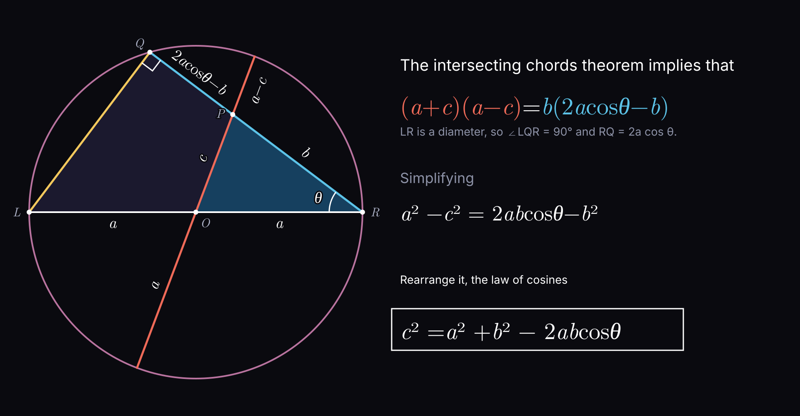

# Law of Cosines

$$
c^2 = a^2 + b^2 - 2ab \cos(C)
$$

Or, rearranged to solve for the angle:

$$
\cos(C) = \frac{a^2 + b^2 - c^2}{2ab}
$$

## Resources

[Law Of Cosines I (visual proof) | Mathematical Visual Proofs ⏵](https://www.youtube.com/watch?v=vNCe7ciFwVc)

[Law Of Cosines II (visual proof) | Mathematical Visual Proofs ⏵](https://www.youtube.com/watch?v=NHxJ3Z_58Lw)
